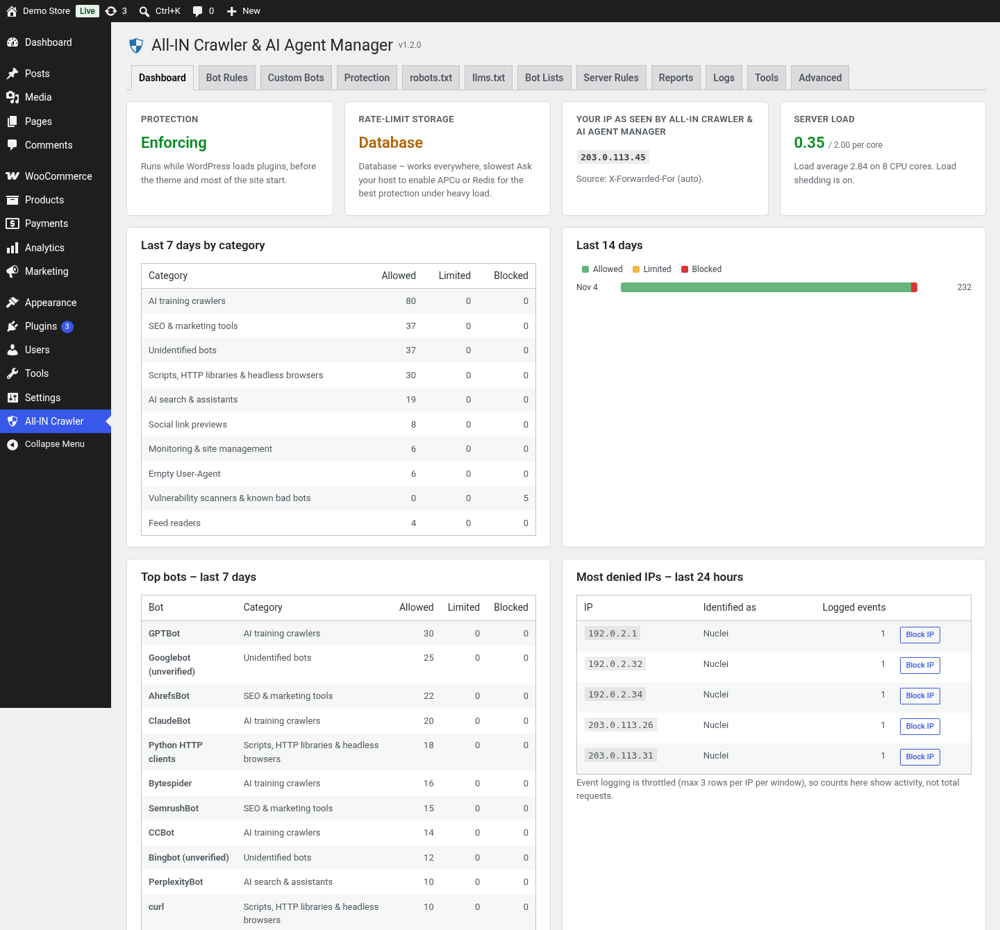
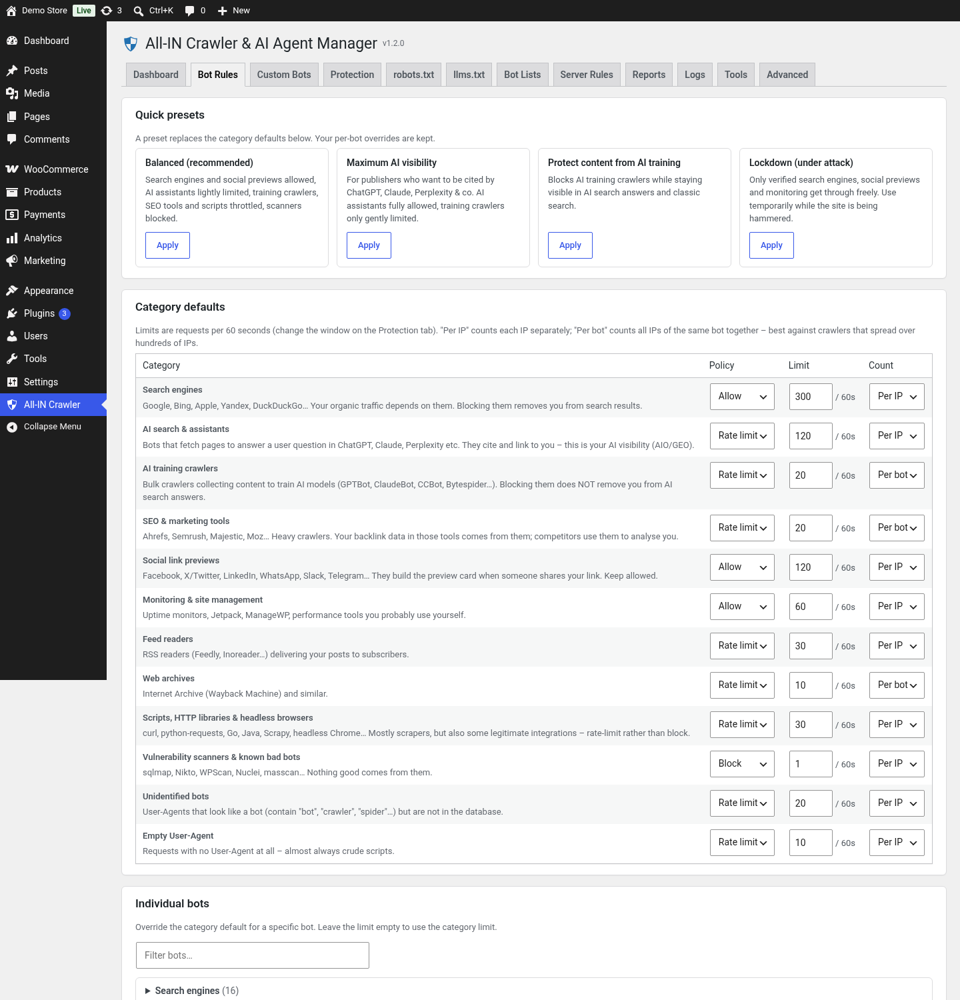
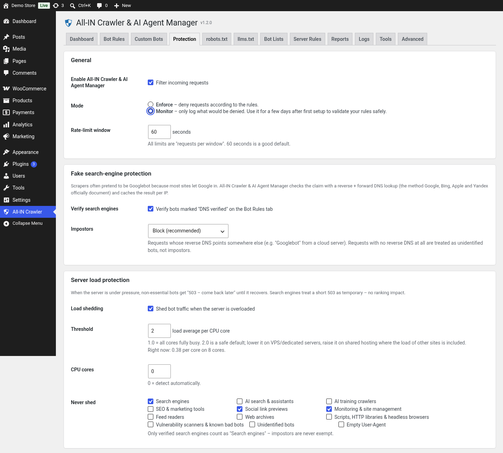
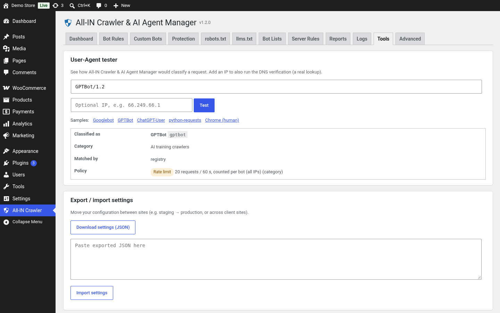
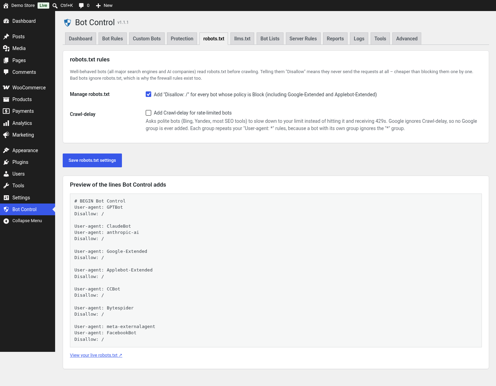

# All-IN Crawler & AI Agent Manager

**All-IN Crawler & AI Agent Manager** is live on WordPress.org.

**[Install it from WordPress.org](https://wordpress.org/plugins/all-in-crawler-ai-agent-manager/)**

Decide which bots, crawlers, AI agents and scrapers may access your site, rate-limit them so none can overload it, and stay visible to the search engines and AI assistants you choose to allow. Slug and text domain: `all-in-crawler-ai-agent-manager`.

More from A-in: [https://a-in.co.il/](https://a-in.co.il/)

## Quick start

1. In WordPress, open **Plugins → Add New**, search for **All-IN Crawler & AI Agent Manager**, and install it. Or [install it from WordPress.org](https://wordpress.org/plugins/all-in-crawler-ai-agent-manager/).
2. Activate the plugin. A **new install starts in Watch-only mode**: it logs what it would do and does not block, rate-limit, shed load, or change `robots.txt`.
3. Open **All-IN Crawler → Dashboard** and confirm that **Your IP** is your real public address. If it is not, set **Advanced → IP source**.
4. Read the **Logs**, then switch to **Enforce** from the banner (or **Protection → Mode**) when you want the rules to apply. An upgrade keeps the mode you already saved.
5. Pick a preset on **Bot Rules**. Balanced is the starting set of category rules.

## Screenshots

### Dashboard

### Bot rules

### Protection

### Tools

### robots.txt

## Repository notes

- No licence check and no custom updater. Updates come from WordPress.org. Optional downloads (official crawler IP lists and a bot-list feed) stay off until you turn them on.
- `.wordpress-org/` holds the directory assets (banners, icons, screenshots) for the SVN `/assets` folder. It is not part of the plugin zip.
- `.distignore` lists what is left out of the plugin zip.
- Documentation: `docs/USER-MANUAL.md` and `docs/DEVELOPER.md`.

License: GPL-2.0-or-later (see LICENSE).
